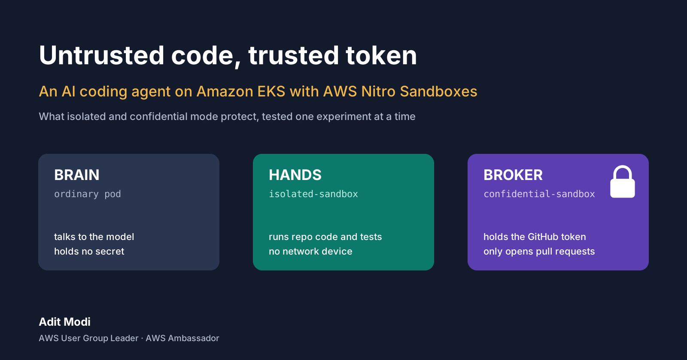
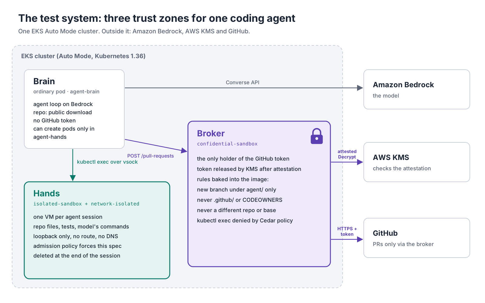
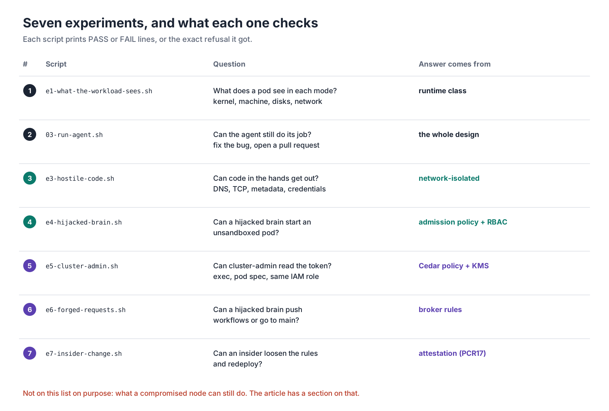

# sandboxed-coding-agent



An AI coding agent on Amazon EKS, split into three trust zones with AWS Nitro Sandboxes, and seven experiments that test what each zone really protects.

- **Brain**, an ordinary pod: the agent loop on Amazon Bedrock. It holds no secret.
- **Hands**, `runtimeClassName: isolated-sandbox` with `sandbox.amazonaws.com/network-isolated: "true"`: one VM per session, with no network. The repository's code, its tests and the model's commands run here.
- **Broker**, `runtimeClassName: confidential-sandbox`: the only process that holds the GitHub token. AWS KMS releases the token only to this pod's measured Cedar policy. The broker only opens pull requests from `agent/*` branches, and never touches `.github/`.

The article that explains every decision is `<link to the AWS Builder Center article>`.



## What you need

- An AWS account where you can create an EKS cluster, IAM roles, a KMS key and ECR repositories.
- Access to an Anthropic Claude model in Amazon Bedrock in your Region.
- A Linux x86_64 machine (glibc 2.34+) with Docker, AWS CLI v2, `kubectl`, `eksctl` and `jq`. An Amazon Linux 2023 EC2 instance works. The policy generator is published for Linux only.
- A GitHub account.

## 0. Prepare GitHub

1. Create a new **public** repository, for example `indian-numbers`, and push the contents of `demo-repo/` to its `main` branch.
2. Create a [fine-grained personal access token](https://github.com/settings/personal-access-tokens/new) for that one repository, with these permissions and nothing else:
   - **Contents**: read and write
   - **Pull requests**: read and write
3. Keep the token ready. `scripts/02-setup.sh` asks for it once, encrypts it with KMS and forgets it.
4. Copy `.env.example` to `.env` and set `GITHUB_REPO=<you>/indian-numbers`.

## 1. Cluster and policy generator

```bash
scripts/00-cluster.sh        # EKS Auto Mode on Kubernetes 1.36, network policy enforced (~15 min)
scripts/01-get-genpolicy.sh  # downloads eks-nitro-sandbox-genpolicy and verifies AWS's signature
```

`00-cluster.sh` ends by listing the two runtime classes that Auto Mode provides: `isolated-sandbox` and `confidential-sandbox`. `01-get-genpolicy.sh` must print `Verified OK` and one `OK` line for each file.

## 2. Build the zones

```bash
scripts/02-setup.sh
```

The script runs these seven steps:

1. Creates the namespaces, the admission policy for `agent-hands` and the brain's RBAC.
2. Creates a KMS key whose first policy denies every decrypt.
3. Asks for the GitHub token and stores only its KMS ciphertext.
4. Creates two IAM roles with EKS Pod Identity: one for the broker, with no policies, and one for the brain, with Bedrock only.
5. Builds both images and records them by digest.
6. Generates the broker's Cedar policy, reads the predicted PCR17, and writes the KMS key policy for that PCR17.
7. Starts the broker. The last line must be `{"event": "broker_unsealed", ...}`.

## 3. Run the experiments

| # | Command | What it tests |
|---|---|---|
| 1 | `experiments/e1-what-the-workload-sees.sh` | the same probe in an ordinary pod, an isolated pod, and an isolated pod with no network |
| 2 | `scripts/03-run-agent.sh` | the agent fixes issue #1 and opens a real pull request |
| 3 | `experiments/e3-hostile-code.sh` | the probe inside a real hands session: every line should be PASS |
| 4 | `experiments/e4-hijacked-brain.sh` | a hijacked brain tries to start pods without the sandbox |
| 5 | `experiments/e5-cluster-admin.sh` | cluster-admin tries `exec`, then decrypting with the broker's own IAM role |
| 6 | `experiments/e6-forged-requests.sh` | forged pull request requests: workflows, `main`, path tricks, CODEOWNERS |
| 7 | `experiments/e7-insider-change.sh` | an insider loosens the broker's rules and redeploys by the book |



## 4. Clean up

```bash
scripts/99-clean.sh            # everything this repo made in AWS, but keep the cluster
scripts/99-clean.sh --cluster  # and the cluster too
```

On GitHub, revoke the token and close the agent's pull requests. The KMS key is deleted after 7 days, which is the shortest wait KMS allows.

## Test without AWS

```bash
cd apps/broker && python -m unittest -v test_rules && python local_flow.py
cd ../../demo-repo && python -m unittest   # 3 failures: that is the bug the agent fixes
```

`local_flow.py` runs the real broker against a fake GitHub on localhost. Only the KMS step is replaced, by a test token.

## Troubleshooting

These come from the Amazon EKS User Guide and the AWS blueprints:

- **The broker container is denied at creation.** The confidential policy pins the pod spec exactly. A webhook that changes the pod after you generated the policy breaks it, and so does a missing `AWS_DEFAULT_REGION`. This repo sets both Region variables for that reason.
- **`broker_sealed` with `AccessDeniedException`.** The PCR17 in the key policy does not match the running pod. Run `scripts/02-setup.sh` again.
- **Pods stay Pending.** The images are built for `amd64` and the broker asks for `amd64` nodes. Check that Auto Mode can launch an x86 instance type that supports Nitro Sandboxes in your Region.
- **HTTP probes fail on hands pods.** That is expected: a network-isolated pod has no network device. Use exec probes.

## Files

| Path | What it is |
|---|---|
| `apps/agent/agent.py` | the brain: Bedrock loop, tools, experiment subcommands |
| `apps/agent/workspace.py` | the hands: one network-less isolated sandbox per session |
| `apps/agent/experiments/probe.py` | what code can see and reach, as PASS and FAIL lines |
| `apps/broker/app.py` | the broker: attested unseal and `POST /pull-requests` |
| `apps/broker/rules.py`, `broker-policy.json` | what a pull request may contain |
| `apps/broker/github.py` | five GitHub REST calls, standard library only |
| `apps/broker/attested_recipient.py` | NSM attestation and CMS unwrap, vendored unchanged from [aws-samples/sample-eks-nitro-sandbox](https://github.com/aws-samples/sample-eks-nitro-sandbox) |
| `demo-repo/` | the target repository, including one hostile test file and a poisoned issue |
| `k8s/`, `policy/` | manifests, admission policy, the KMS key policy template, the generator profile |
| `docs/make_images.py` | draws every image in `docs/images/` |

Built on the [Amazon EKS Nitro Sandbox blueprints](https://github.com/aws-samples/sample-eks-nitro-sandbox), especially their coding-agent and confidential samples. MIT-0.
