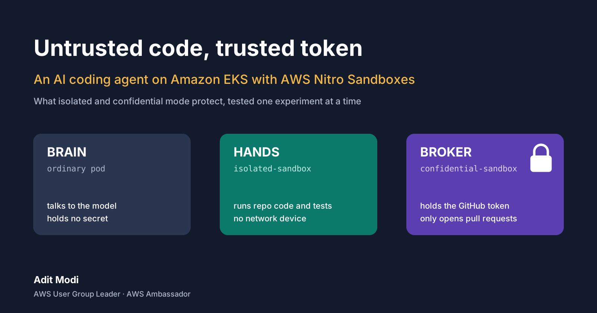
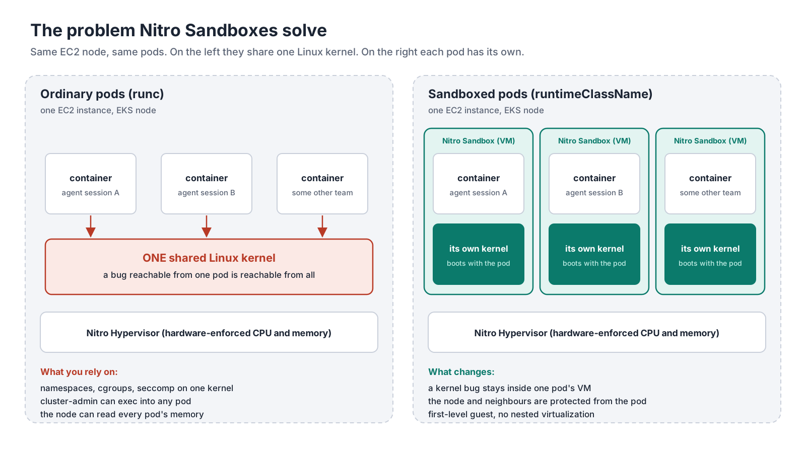
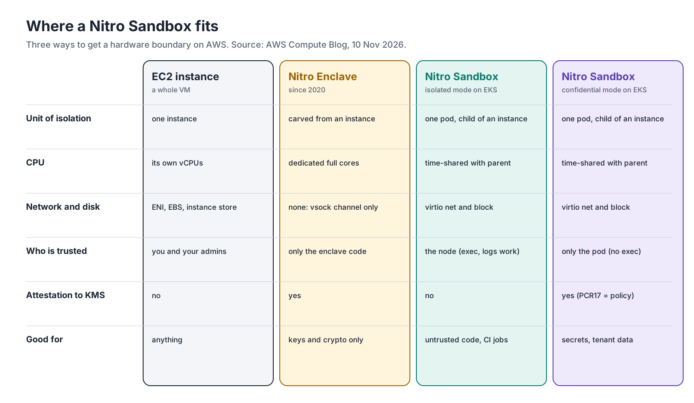
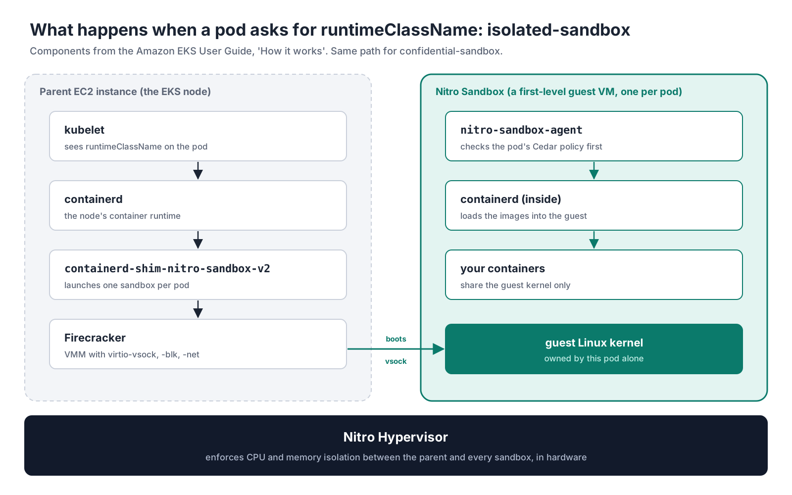
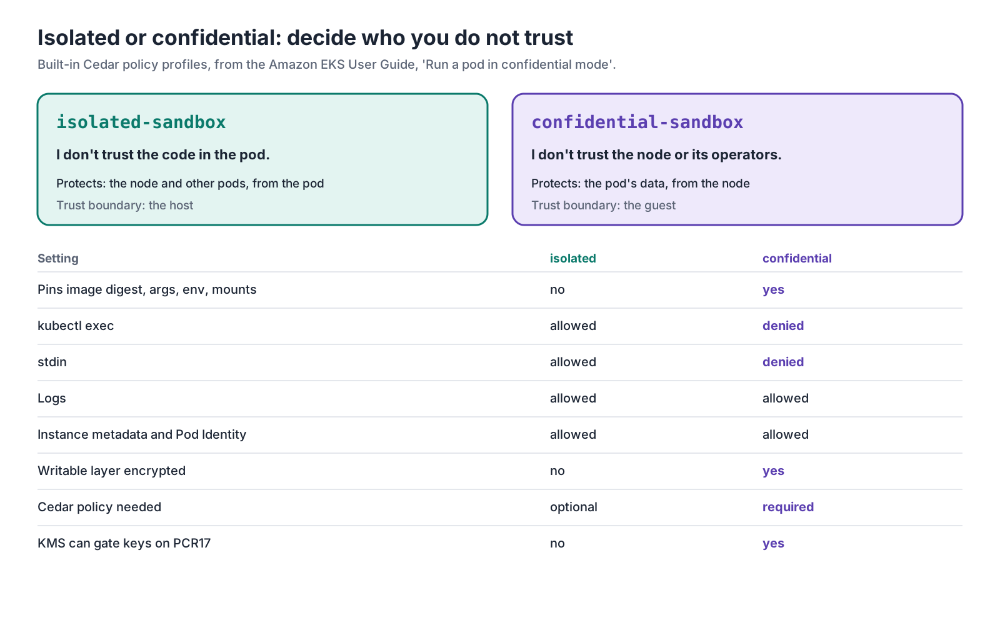
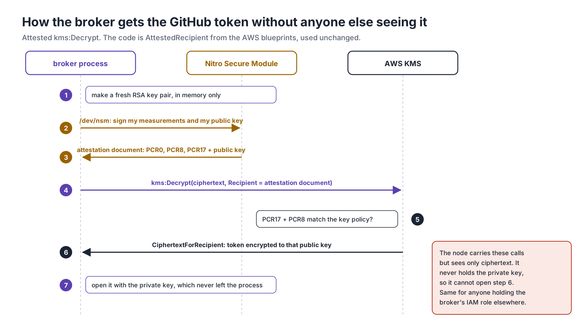
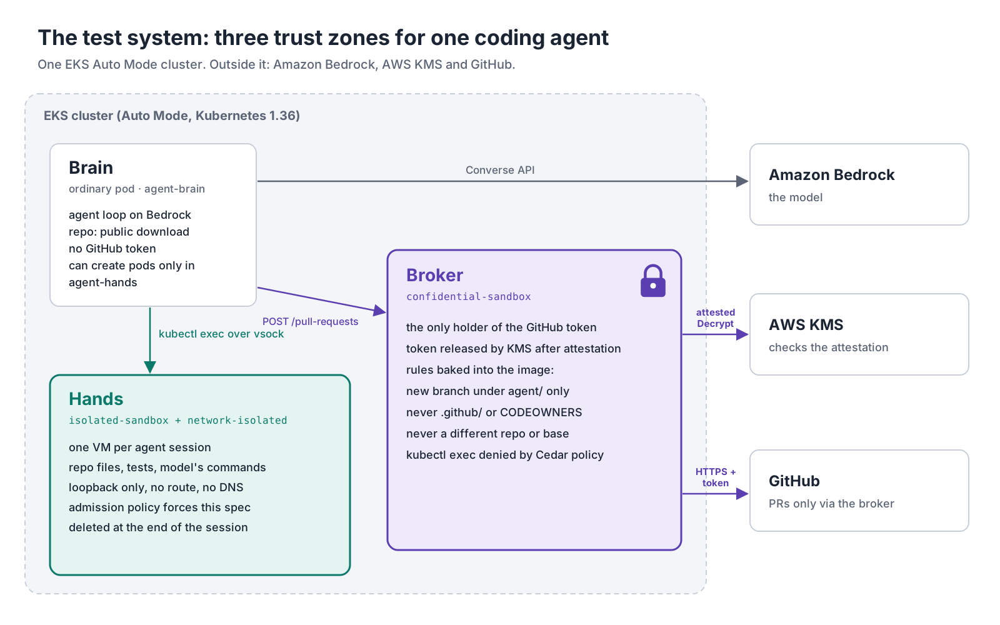
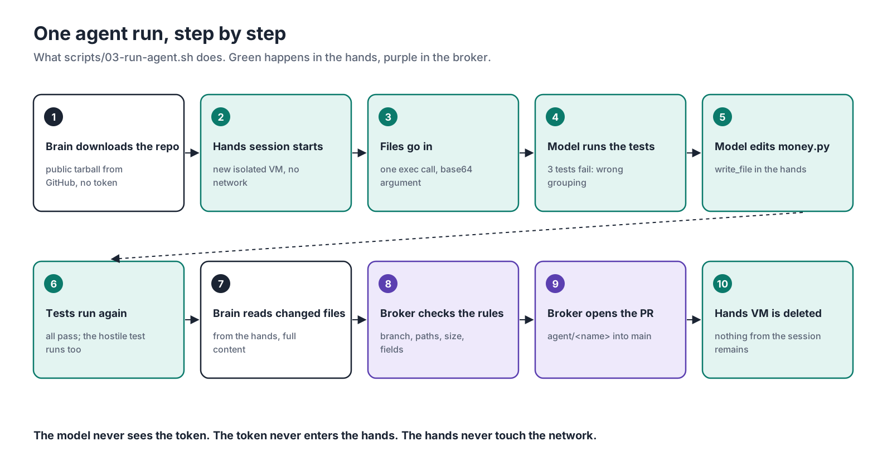
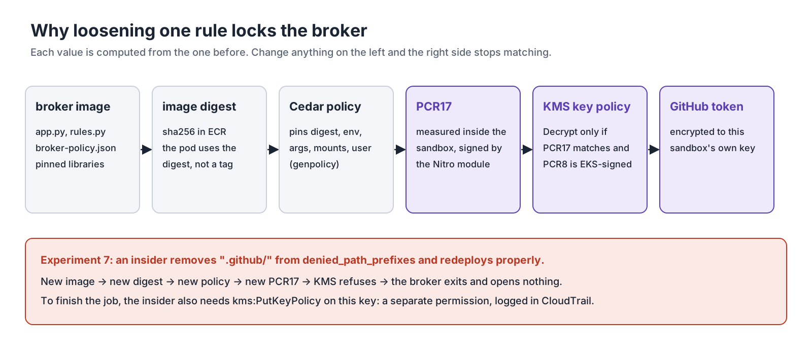
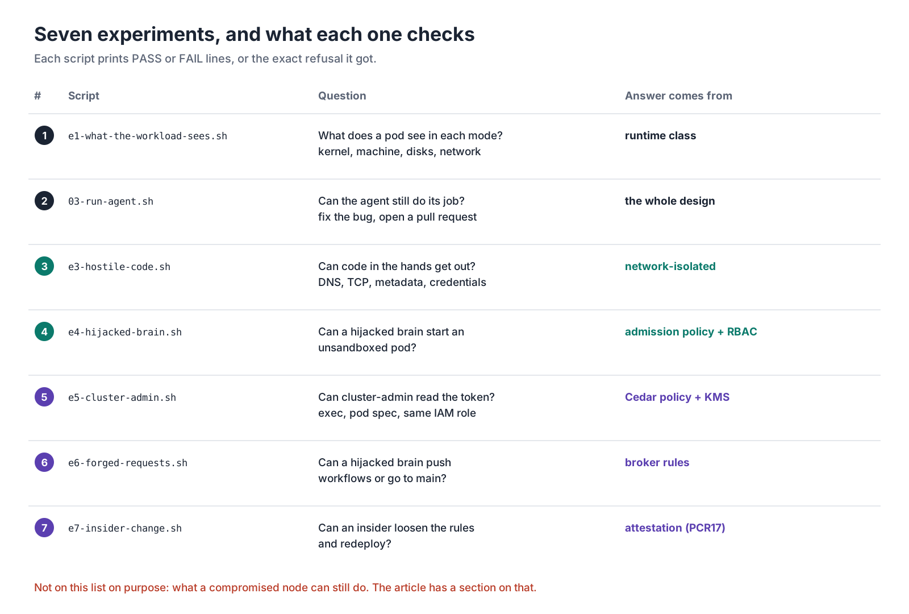

# Diagrams

All ten diagrams in reading order. Each PNG has an SVG next to it, and `make_images.py` redraws them all (`pip install cairosvg`, then `python docs/make_images.py`).

## 1. Sandboxed coding agent on EKS

## 2. The problem Nitro Sandboxes solve
Same EC2 node, same pods. Ordinary pods share one Linux kernel; sandboxed pods each get their own.

## 3. Where a Nitro Sandbox fits
Three ways to get a hardware boundary on AWS: EC2 instances, Nitro Enclaves and Nitro Sandboxes.

## 4. What happens when a pod asks for `runtimeClassName: isolated-sandbox`

## 5. Isolated or confidential: decide who you do not trust

## 6. How the broker gets the GitHub token without anyone else seeing it
AWS KMS releases the token only to a sandbox whose measured policy matches the key policy.

## 7. The test system: three trust zones for one coding agent
Brain (ordinary pod), hands (isolated sandbox, no network), broker (confidential sandbox, holds the token).

## 8. One agent run, step by step
What `scripts/03-run-agent.sh` does.

## 9. Why loosening one rule locks the broker
The broker's rules are baked into its image, the image is pinned in its Cedar policy, and the policy sets PCR17. Change a rule and the KMS key policy no longer matches.

## 10. Seven experiments, and what each one checks

